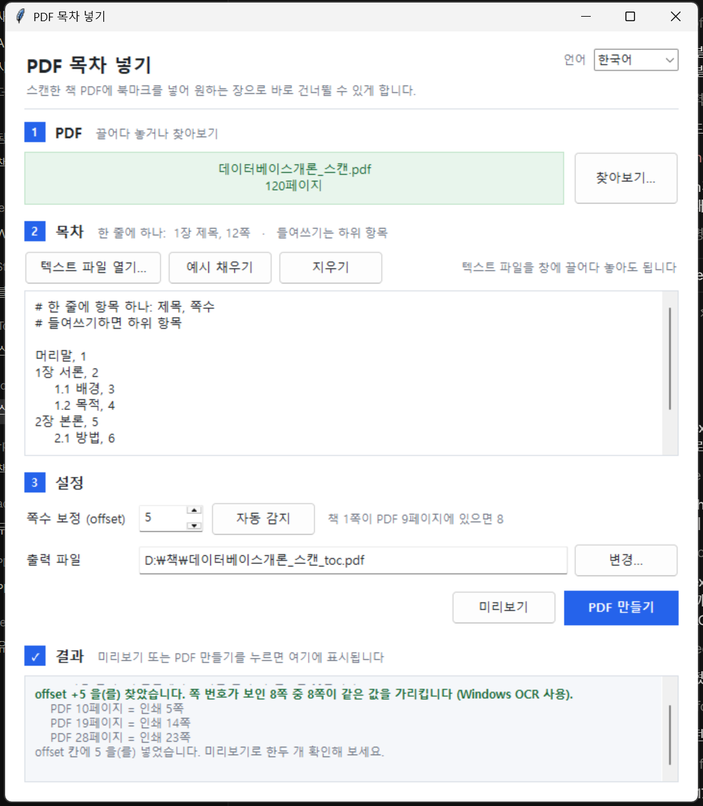

# PDF 목차 넣기 · PDF TOC Bookmarks · PDF 目录书签 · PDF 目次しおり

[한국어](#한국어) · [English](#english) · [中文](#中文) · [日本語](#日本語)

**[⬇ Download pdf_toc_add.exe (Windows)](https://github.com/microhan1/pdf-toc-add/releases/latest)** · No installation needed



---

## 한국어

스캔한 책 PDF는 북마크가 없어서 원하는 장으로 바로 못 건너뜁니다.
텍스트 파일에 `제목, 쪽수` 를 적어 주면 그대로 PDF 북마크(아웃라인)로 박아 주는 툴입니다.
화면과 메시지는 한국어, 영어, 중국어, 일본어를 지원합니다.

### exe 로 쓰기 (설치 불필요)

[Releases](https://github.com/microhan1/pdf-toc-add/releases/latest) 에서 `pdf_toc_add.exe` 를 내려받아 더블클릭하면 창이 뜹니다. 서명이 없는 exe 라 처음에 Windows SmartScreen 경고가 뜨면 "추가 정보 → 실행" 을 누르세요.

- PDF 는 창에 **끌어다 놓거나** 찾아보기로 고릅니다. exe 아이콘 위에 PDF 를 놓아도 됩니다.
- 목차는 **텍스트 파일을 끌어다 놓거나** 열기 버튼으로 불러오고, 입력칸에 **직접 타이핑**해도 됩니다.
- PDF 를 넣으면 **offset 을 자동으로 찾습니다.** 스캔 이미지의 쪽 번호를 Windows 내장 OCR 로 읽습니다. PDF 에 글자 층이 있으면 그것을 씁니다. 확실하지 않으면 답을 내지 않으니 그때는 직접 입력합니다.
- 미리보기로 연결 페이지를 확인한 뒤 PDF 만들기를 누릅니다.
- 언어는 오른쪽 위에서 바꿉니다. Windows 표시 언어에 맞춰 자동 선택되고, 바꾸면 기억됩니다.

자세한 설명은 [usage.html](usage.html) 을 보세요.

### 목차 파일 형식

```
offset=8

머리말, 1
1장 서론, 12쪽
    1.1 배경, 13
2장 본론 ...... 25
3장 결론, 40
```

- 줄 끝 숫자가 쪽수입니다. 쉼표, 탭, 점선, `p.`, `쪽` 은 있어도 없어도 됩니다.
- 들여쓰기하면 하위 항목. `#` 줄과 빈 줄은 무시.
- `offset=8` 은 인쇄 쪽수와 PDF 페이지 차이입니다. 책 1쪽이 PDF 9페이지면 8. 창의 [자동 감지] 나 `--auto-offset` 으로 찾을 수도 있습니다.
- UTF-8, UTF-16, CP949, GB18030 자동 판별.

### 명령줄

```bash
pip install -r requirements.txt
python pdf_toc_add.py 책.pdf 목차.txt [--offset 8 | --auto-offset] [-o 결과.pdf] [--dry-run] [--lang ko|en|zh|ja]
```

### 오류 처리

- 잘못된 줄을 전부 모아 행 번호, 원문, 고치는 방법을 보여주고, GUI 에서는 그 줄을 빨갛게 표시합니다.
- 잡아내는 것: 쪽수 없는 줄, 로마 숫자 쪽수, 숫자만 있는 줄, 쪽수 0, 잘못된 offset 값, PDF 범위를 벗어난 쪽수, 목차 자리의 PDF/이미지/Word 파일, PDF 가 아닌 파일, 손상되거나 암호 걸린 PDF, 잠긴 출력 파일, 없는 출력 폴더.
- 경고만 하는 것: 쪽수 범위(`12-15` 는 12 사용), 앞 항목보다 작은 쪽수, `#` 주석이 된 항목, offset 줄 중복.

### 새 버전 확인

실행할 때 새 버전이 있는지 확인하려고 도구 이름과 버전만 책갈피 서버(chaekgalpi.co.kr)에 보냅니다. 파일은 보내지 않고, 하루 한 번만 확인하며, 설정에서 끌 수 있습니다.

- 새 버전이 있으면 창 맨 아래에 한 줄로 알려 줍니다. 대화상자를 띄우지 않으므로 작업을 막지 않습니다.
- 새 버전을 자동으로 내려받거나 바꾸지 않습니다. [업데이트]를 누르면 툴 소개 페이지만 열립니다.
- [다음에]를 누르면 그 버전은 다시 알리지 않습니다. 「3 설정」의 **새 버전 확인** 체크를 끄면 아예 묻지 않습니다.
- 확인이 실패하면(인터넷이 없거나 서버가 조용하면) 아무 말 없이 지나갑니다. 설정은 `%APPDATA%\pdf_toc_add\config.json` 에 저장됩니다.

### 의견 보내기

안 되는 것·불편한 것·바라는 기능은 프로그램의 「3 설정」에 있는 **의견 보내기**를 누르거나 https://chaekgalpi.co.kr/tools/pdftoc#feedback 에서 로그인 없이 보낼 수 있습니다(프로그램은 브라우저로 그 페이지를 열기만 합니다). [GitHub Issues](https://github.com/microhan1/pdf-toc-add/issues) 도 그대로 받습니다.

### 개발

```bash
pip install -r requirements.txt pytest pyinstaller
python -m pytest tests -q
python -m PyInstaller --onefile --windowed --name pdf_toc_add pdf_toc_add.py
```

빌드된 exe 는 저장소에 넣지 않고 GitHub Releases 에 올립니다.

offset 자동 감지는 정답을 아는 합성 스캔 책으로 검증합니다: `python tools/validate_offset.py collect train`, `collect validation`, `tune`.

문자열은 [i18n.py](i18n.py) 한 곳에 모여 있습니다. 언어를 추가하려면 `STRINGS` 에 표를 하나 더 넣고 `LANGS`, `LANG_NAMES` 에 등록하면 됩니다.

책을 다 읽었다면 [책갈피 라이브러리](https://chaekgalpi.co.kr/tools/pdftoc?utm_source=github&utm_medium=referral&utm_campaign=tool_cta&utm_content=pdftoc)에 기록해 보세요. 읽은 책과 독서록을 남기는 웹 서비스입니다.

---

## English

Scanned book PDFs have no bookmarks, so you cannot jump to a chapter.
This tool takes a plain-text list of `title, page` lines and writes them into the PDF as bookmarks (an outline).
The interface and messages are available in Korean, English, Chinese and Japanese.

### Using the exe (no install)

Download `pdf_toc_add.exe` from [Releases](https://github.com/microhan1/pdf-toc-add/releases/latest) and double-click it. The exe is unsigned, so if Windows SmartScreen appears the first time, click "More info → Run anyway".

- **Drag and drop** the PDF onto the window, or use Browse. Dropping a PDF onto the exe icon also works.
- **Drop a text file** for the table of contents, open one with the button, or **type it directly**.
- When a PDF is added, **the offset is detected automatically** by reading the printed page numbers with the built-in Windows OCR, or from the PDF text layer when there is one. If the result is not certain, no value is set and you enter it yourself.
- Press Preview to check the page mapping, then Create PDF.
- The language selector is at the top right. It follows the Windows display language and remembers your choice.

See [usage.html](usage.html) for the full guide.

### TOC file format

```
offset=8

Preface, 1
Chapter 1 Introduction, 12
    1.1 Background, 13
Chapter 2 Body ...... 25
Chapter 3 Conclusion p.40
```

- The number at the end of the line is the page. Commas, tabs, dot leaders, `p.` and `page` are optional.
- Indent for sub-entries. `#` lines and blank lines are ignored.
- `offset=8` is the difference between printed and PDF page numbers: if book page 1 is PDF page 9, use 8. [Auto-detect] in the window or `--auto-offset` can find it for you.
- UTF-8, UTF-16, CP949 and GB18030 are detected automatically.

### Command line

```bash
pip install -r requirements.txt
python pdf_toc_add.py book.pdf toc.txt [--offset 8 | --auto-offset] [-o out.pdf] [--dry-run] [--lang ko|en|zh|ja]
```

### Error handling

- Every bad line is reported at once with its line number, the original text and how to fix it. The GUI highlights those lines in red.
- Caught: missing page numbers, Roman-numeral pages, number-only lines, page 0, bad offset values, pages outside the PDF, PDF/image/Word files given as the TOC, non-PDF or damaged or password-protected PDFs, locked output files, missing output folders.
- Warnings only: page ranges (`12-15` uses 12), pages smaller than the previous entry, entries commented out with `#`, duplicate offset lines.

### Checking for a new version

On start the tool sends only its name and version to the Chaekgalpi server (chaekgalpi.co.kr) to ask whether a newer version exists. No files are sent, it asks once a day, and you can switch it off.

- When a newer version exists, one line appears at the bottom of the window. There is no dialog, so nothing blocks your work.
- Nothing is downloaded or replaced automatically. **Update** only opens the tool's page.
- **Later** silences that version; unticking **Check for updates** in section 3 stops the question altogether.
- A failed check (offline, or a quiet server) passes silently. Settings live in `%APPDATA%\pdf_toc_add\config.json`.

### Feedback

Tell us what's broken or missing with **Send feedback** in section 3 of the window, or at https://chaekgalpi.co.kr/en/tools/pdftoc#feedback — no sign-in needed (the tool only opens that page in your browser). [GitHub Issues](https://github.com/microhan1/pdf-toc-add/issues) are still welcome.

### Development

```bash
pip install -r requirements.txt pytest pyinstaller
python -m pytest tests -q
python -m PyInstaller --onefile --windowed --name pdf_toc_add pdf_toc_add.py
```

All strings live in [i18n.py](i18n.py). To add a language, add a table to `STRINGS` and register it in `LANGS` and `LANG_NAMES`.

Finished the book? Log it on [Chaekgalpi Library](https://chaekgalpi.co.kr/en/tools/pdftoc?utm_source=github&utm_medium=referral&utm_campaign=tool_cta&utm_content=pdftoc), a web service for keeping track of the books you read (tools page in English; the reading-log service itself is in Korean).

---

## 中文

扫描的图书 PDF 没有书签，无法直接跳转到某一章。
本工具读取写有 `标题, 页码` 的文本文件，并将其写入 PDF 作为书签（大纲）。
界面和提示支持韩语、英语、中文和日语。

### 使用 exe（无需安装）

从 [Releases](https://github.com/microhan1/pdf-toc-add/releases/latest) 下载 `pdf_toc_add.exe` 并双击运行。exe 未签名，首次运行若出现 Windows SmartScreen 提示，请点击“更多信息 → 仍要运行”。

- 把 PDF **拖入窗口**或点“浏览”。把 PDF 拖到 exe 图标上也可以。
- 目录可以**拖入文本文件**、用按钮打开，或**直接输入**。
- 放入 PDF 后会**自动检测 offset**：用 Windows 内置 OCR 读取扫描图像中的页码；PDF 带文字层时直接使用文字层。结果不确定时不会填入，请手动输入。
- 点“预览”确认页码对应关系，再点“生成 PDF”。
- 语言在右上角切换。默认跟随 Windows 显示语言，切换后会记住。

详细说明见 [usage.html](usage.html)。

### 目录文件格式

```
offset=8

前言, 1
第1章 绪论, 12
    1.1 背景, 13
第2章 正文 ...... 25
第3章 结论 第40页
```

- 行尾数字为页码。逗号、制表符、点线、`第`、`页` 有无均可。
- 缩进表示子项。`#` 行和空行会被忽略。
- `offset=8` 是印刷页码与 PDF 页码之差：书的第 1 页是 PDF 第 9 页时填 8。也可以用窗口中的“自动检测”或 `--auto-offset` 查找。
- 自动识别 UTF-8、UTF-16、GB18030、CP949。

### 命令行

```bash
pip install -r requirements.txt
python pdf_toc_add.py book.pdf toc.txt [--offset 8 | --auto-offset] [-o out.pdf] [--dry-run] [--lang ko|en|zh|ja]
```

### 错误处理

- 一次列出所有问题行，包括行号、原文和修改方法；GUI 中会将这些行标红。
- 可检测：缺少页码、罗马数字页码、只有数字的行、页码 0、offset 值无效、页码超出 PDF 范围、把 PDF/图片/Word 文件当作目录、非 PDF 或损坏或加密的 PDF、被占用的输出文件、不存在的输出文件夹。
- 仅警告：页码范围（`12-15` 取 12）、页码小于前一项、被 `#` 注释掉的条目、重复的 offset 行。

### 检查新版本

启动时仅把工具名称和版本发送到书签服务器（chaekgalpi.co.kr），以询问是否有新版本。不会发送任何文件，每天只检查一次，并且可以关闭。

- 有新版本时，窗口底部只显示一行提示。不弹出对话框，不会打断操作。
- 不会自动下载或替换程序。点击 **更新** 只会打开工具介绍页面。
- 点击 **以后** 后不再提示该版本；在「3 设置」中取消勾选 **检查新版本** 即可完全关闭。
- 检查失败（无网络或服务器无响应）时静默跳过。设置保存在 `%APPDATA%\pdf_toc_add\config.json`。

### 发送反馈

问题或建议可以点击窗口「3 设置」中的 **发送反馈**，或在 https://chaekgalpi.co.kr/en/tools/pdftoc#feedback 提交，无需登录（程序只会用浏览器打开该页面）。也照常接受 [GitHub Issues](https://github.com/microhan1/pdf-toc-add/issues)。

### 开发

```bash
pip install -r requirements.txt pytest pyinstaller
python -m pytest tests -q
python -m PyInstaller --onefile --windowed --name pdf_toc_add pdf_toc_add.py
```

所有字符串都在 [i18n.py](i18n.py) 中。要新增语言，在 `STRINGS` 中添加一张表，并在 `LANGS` 和 `LANG_NAMES` 中登记即可。

读完这本书后，可以在 [书签图书馆（Chaekgalpi Library）](https://chaekgalpi.co.kr/tools/pdftoc?utm_source=github&utm_medium=referral&utm_campaign=tool_cta&utm_content=pdftoc) 记录下来——这是一个记录读过的书和读书笔记的网页服务（仅韩语）。

---

## 日本語

スキャンした本の PDF にはしおり（ブックマーク）がないため、読みたい章へすぐ移動できません。
テキストファイルに `タイトル, ページ` を書いておくと、そのまま PDF のしおり（アウトライン）として入れるツールです。
画面とメッセージは韓国語、英語、中国語、日本語に対応しています。

### exe で使う（インストール不要）

[Releases](https://github.com/microhan1/pdf-toc-add/releases/latest) から `pdf_toc_add.exe` をダウンロードし、ダブルクリックするとウィンドウが開きます。署名のない exe のため、初回に Windows SmartScreen の警告が出たら「詳細情報 → 実行」を押してください。

- PDF はウィンドウに**ドラッグ＆ドロップ**するか、［参照…］で選びます。exe のアイコンに PDF をドロップしてもかまいません。
- 目次は**テキストファイルをドロップ**するか、ボタンで開きます。入力欄に**直接入力**してもかまいません。
- PDF を入れると **offset を自動で探します。** スキャン画像のページ番号を Windows 内蔵の OCR で読み取ります。PDF にテキスト層があればそれを使います。確実でないときは値を入れないので、その場合は直接入力してください。
- ［プレビュー］で対応するページを確かめてから［PDF を作成］を押します。
- 言語は右上で切り替えます。Windows の表示言語に合わせて自動で選ばれ、切り替えると次回も覚えています。

詳しい説明は [usage.html](usage.html) をご覧ください（韓国語・英語・中国語）。

### 目次ファイルの書き方

```
offset=8

はじめに, 1
第1章 序論, 12
    1.1 背景, 13
第2章 本論 ...... 25
第3章 結論 p.40
```

- 行末の数字がページ番号です。カンマ、タブ、点線、`p.`、`頁` はあってもなくてもかまいません（`ページ` は未対応なので、`12ページ` は `12` と書いてください）。
- 字下げすると下位の項目になります。`#` で始まる行と空行は無視します。
- `offset=8` は本のページ番号と PDF のページ番号の差です。本の 1 ページ目が PDF の 9 ページ目なら 8。ウィンドウの［自動検出］や `--auto-offset` で探すこともできます。
- UTF-8、UTF-16、CP949、GB18030 を自動判別します。Shift_JIS は自動判別できないため、メモ帳で UTF-8 に保存し直すか、コマンドラインでは `--encoding cp932` を指定してください。

### コマンドライン

```bash
pip install -r requirements.txt
python pdf_toc_add.py book.pdf toc.txt [--offset 8 | --auto-offset] [-o out.pdf] [--dry-run] [--lang ko|en|zh|ja]
```

### エラー処理

- 問題のある行をまとめて、行番号・元の文・直し方を表示します。GUI ではその行を赤く示します。
- 検出するもの: ページ番号のない行、ローマ数字のページ番号、数字だけの行、ページ 0、正しくない offset の値、PDF の範囲を外れたページ、目次の欄に入れた PDF・画像・Word ファイル、PDF でないファイル、壊れた PDF やパスワード付きの PDF、ほかのプログラムが開いている出力ファイル、存在しない出力フォルダー。
- 警告だけのもの: ページの範囲（`12-15` は 12 を使用）、前の項目より小さいページ番号、`#` でコメントになった項目、offset 行の重複。

### 新しいバージョンの確認

起動時に新しいバージョンがあるか確かめるため、ツール名とバージョンだけを Chaekgalpi のサーバー（chaekgalpi.co.kr）に送ります。ファイルは送りません。確認は 1 日 1 回だけで、設定でオフにできます。

- 新しいバージョンがあると、ウィンドウの一番下に 1 行で知らせます。ダイアログは出さないので、作業を妨げません。
- 新しいバージョンを自動でダウンロードしたり置き換えたりはしません。［更新］を押すとツールの紹介ページ（英語）が開くだけです。
- ［後で］を押すと、そのバージョンは二度と知らせません。「3 設定」の**新しいバージョンを確認**のチェックを外すと、確認そのものをしません。
- 確認に失敗したとき（インターネットにつながっていない、サーバーが応答しないなど）は何も言わずに続けます。設定は `%APPDATA%\pdf_toc_add\config.json` に保存されます。

### ご意見を送る

うまく動かないこと・使いにくいこと・ほしい機能は、プログラムの「3 設定」にある**ご意見を送る**を押すか、https://chaekgalpi.co.kr/en/tools/pdftoc#feedback からログインなしで送れます（英語のページです。プログラムはブラウザーでそのページを開くだけです）。[GitHub Issues](https://github.com/microhan1/pdf-toc-add/issues) もこれまでどおり受け付けます。

### 開発

```bash
pip install -r requirements.txt pytest pyinstaller
python -m pytest tests -q
python -m PyInstaller --onefile --windowed --name pdf_toc_add pdf_toc_add.py
```

文字列はすべて [i18n.py](i18n.py) にまとまっています。言語を増やすには `STRINGS` に表を一つ足し、`LANGS` と `LANG_NAMES` に登録します。

本を読み終えたら、[Chaekgalpi Library](https://chaekgalpi.co.kr/en/tools/pdftoc?utm_source=github&utm_medium=referral&utm_campaign=tool_cta&utm_content=pdftoc) に記録してみてください。読んだ本と読書記録を残せるウェブサービスです（ツールの紹介ページは英語、読書記録サービス自体は韓国語です）。
